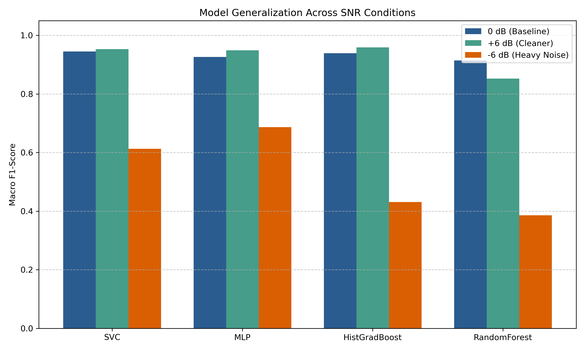
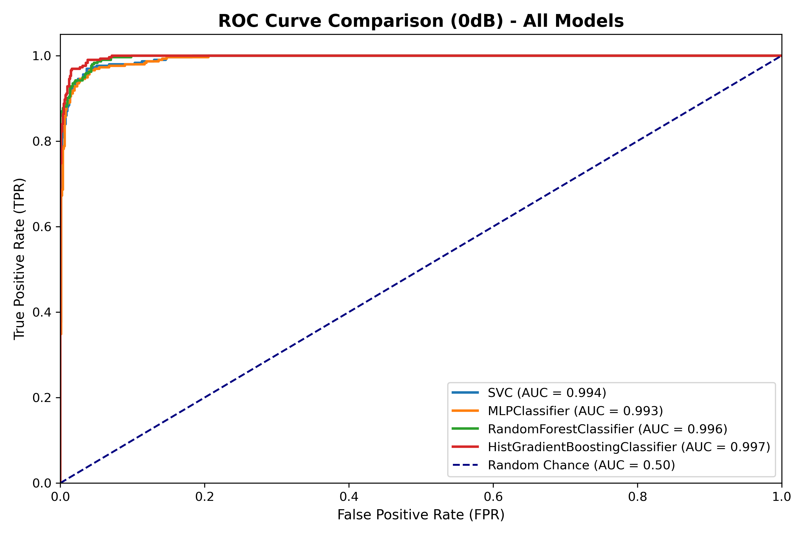
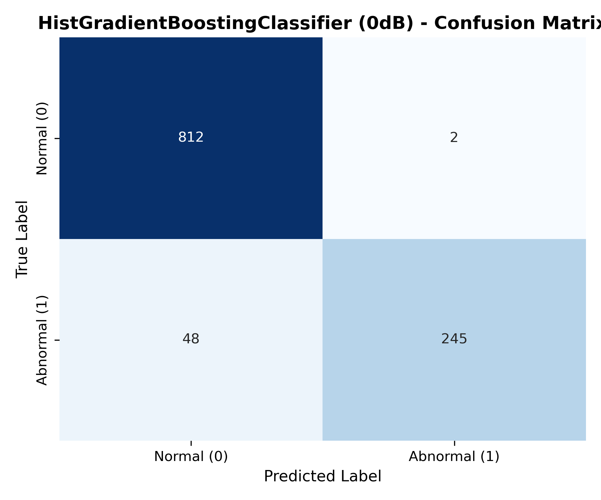
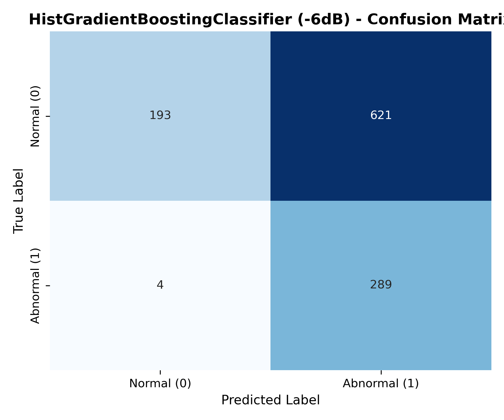
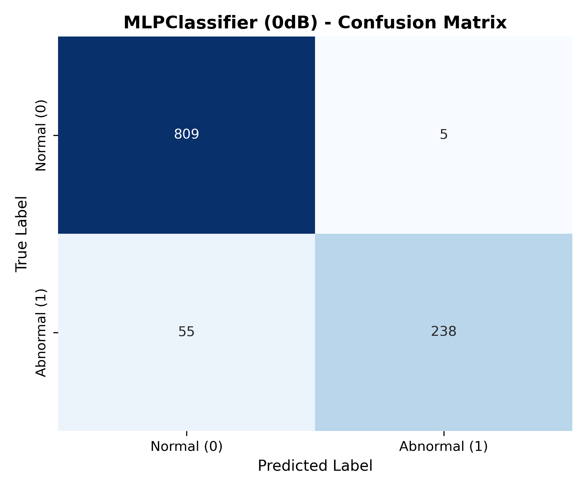
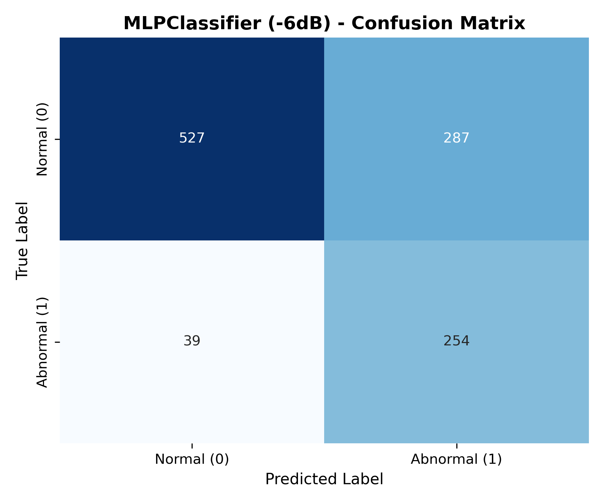

# Industrial Fan Anomaly Detection in Dynamic SNR Environments: Evaluating Classifiers and Acoustic Noise Robustness

## Short Introduction
This project was done under supervision of prof.dr. Amira Šerifović-Trbalić at the Department of Automation and Robotics, Faculty of Electrical Engineering, University of Tuzla. Factory machinery is prone to unexpected failure and breakdown, resulting in significant operational downtime and costly repairs. Industrial fans are critical components used for continuous ventilation in manufacturing facilities. Detecting malfunctioning operating conditions early is essential for facility maintenance, but relying solely on manual inspection by field engineers is increasingly difficult due to a shortage of domain experts. Non-invasive acoustic monitoring using microphone arrays provides an efficient solution to continuously assess machine health.

## Classification Approach
The project aims to provide insight into plausible methods of detecting mechanical anomalies in industrial fans so that equipment failures can be handled proactively by facility engineers. Sound recordings have shown to be efficient sources of data to indicate machine health, specifically because rotational unbalance, friction, voltage changes, and clogging directly alter the acoustic spectrum and temporal dynamics of the fan. The project therefore tries to classify 10-second sound recordings as either from a normally behaving fan or from a fan operating under an anomalous condition. Different classifiers are used:
- Support Vector Classifier 
- Multilayer Perceptron
- Random Forest Classifier
- Histogram-based Gradient Boosting Classifier

## Dataset
The project utilizes the [MIMII dataset ("Sound Dataset for Malfunctioning Industrial Machine Investigation and Inspection")](https://zenodo.org/records/3384388). The dataset contains real-world industrial fan sounds across multiple product models (`id_00` through `id_06`), mixed with real factory background noise at three distinct Signal-to-Noise Ratios: 0 dB, 6 dB, and -6 dB. The presence of heavy background noise at lower SNRs presents a hardship in terms of achieving high scores, but it introduces a realistic way to evaluate out-of-distribution acoustic generalization and model robustness. As anomalous machine events occur less frequently during standard operation, the dataset is naturally imbalanced.

## Preprocessing Methods 
Experienced field engineers have been listening to the operational sound of machinery for decades to spot subtle pitch shifts and acoustic irregularities. Because of this, the idea of using Mel-Spectrograms is intuitively inferred as this representation tries to mimic the human perception of sounds. To capture dynamic changes in fan operation, static Mel energy statistics are augmented with temporal deltas, delta-deltas, and global bioacoustic descriptors such as zero-crossing rate, RMS power, and spectral flatness. To guarantee zero data leakage across continuous recording sessions and SNR levels, chronological block splitting is executed at the base filename level with a 20-file (~200-second) temporal purge window between training and test sets. Relative-time interleaving is applied to ensure balanced multi-machine representation across cross-validation folds, while class imbalance is accounted for during model training using balanced class weighting. The feature structure of a sample was experimented with, initially PCA was used because of relatively large numbers of features, later PCA was removed from the pipeline because the final choice of the sample structure had a manageable number of features.

## Hyperparameter Optimization
To maximize classification performance and eliminate manual tuning bias, hyperparameter tuning is conducted using Bayesian Optimization via Optuna. Each estimator pipeline is optimized independently over 35 trials on the 0 dB training set (`train_0dB.csv`), directly targeting the macro-averaged F1-score across validation folds.

### Cross-Validation Strategy
Hyperparameter evaluation relies on a custom 3-fold `PurgedStratifiedKFold` cross-validation scheme with a `purge_gap` of 15 files (~150 seconds). This ensures that validation folds remain temporally isolated from training folds within the training window, preventing short-term autocorrelation leakage. Relative-time interleaving is preserved across folds to ensure balanced multi-machine representation during tuning.

### Search Spaces
- **Support Vector Classifier (SVC):**
  - `estimator__kernel`: Categorical choice between `poly` and `rbf`.
  - `estimator__C`: Log-uniform continuous distribution from $10^{-3}$ to $100$.
  - `estimator__gamma`: Log-uniform continuous range anchored around dataset variance ($\gamma_{\text{base}} \times 10^{-2}$ to $\gamma_{\text{base}} \times 10^{2}$).
- **Multilayer Perceptron (MLPClassifier):**
  - `estimator__hidden_layer_sizes`: Single- and multi-layer architectures ranging from `(128,)` to `(512, 256, 128)`.
  - `estimator__alpha` (L2 Penalty): Log-uniform continuous distribution from $10^{-6}$ to $10^{-1}$.
  - `estimator__learning_rate_init`: Log-uniform continuous distribution from $10^{-4}$ to $3 \times 10^{-2}$.
- **Random Forest Classifier:**
  - `estimator__max_depth`: Discrete integer range from 8 to 32.
  - `estimator__min_samples_split`: Discrete integer range from 2 to 30.
  - `estimator__min_samples_leaf`: Discrete integer range from 1 to 20.
  - `estimator__max_features`: Categorical selection among `sqrt`, `log2`, and feature ratio floats (0.2 to 1.0).
- **Histogram-based Gradient Boosting Classifier:**
  - `estimator__max_depth`: Discrete integer range from 2 to 16.
  - `estimator__learning_rate`: Log-uniform continuous distribution from 0.005 to 0.1.
  - `estimator__l2_regularization`: Log-uniform continuous distribution from $10^{-6}$ to 1.0.
  - `estimator__min_samples_leaf`: Discrete integer range from 2 to 30.
  - `estimator__max_leaf_nodes`: Discrete integer range from 7 to 63.

Trial pruning is handled dynamically using Optuna's median pruner to terminate unpromising trials early. The best hyperparameter configuration for each model is saved together with the fitted pipeline in the `models/` directory.

## Experimental Results and Discussions
Models were trained exclusively on 0 dB baseline operational audio (`train_0dB.csv`) and sequentially evaluated across three distinct noise environments: 0 dB (in-distribution control), +6 dB (reduced noise control), and -6 dB (acoustic stress test). Extensive visualization of the results can be found in the `results/` directory. Precision and Recall values relate to the abnormal class. 

### Multi-SNR Performance Matrix

| Model | Metric | 0 dB (Control) | +6 dB (Cleaner Noise) | -6 dB (Noise Stress Test) |
| :--- | :--- | :---: | :---: | :---: |
| **Support Vector Classifier (SVC)** | **Accuracy** | **0.9584** | 0.9648 | 0.6188 |
| | **Macro Precision** | 0.9635 | **0.9743** | 0.6791 |
| | **Macro Recall** | 0.9291 | 0.9356 | 0.7189 |
| | **Macro F1-Score** | **0.9446** | 0.9529 | 0.6127 |
| **Multilayer Perceptron (MLP)** | **Accuracy** | 0.9458 | 0.9621 | **0.7055** |
| | **Macro Precision** | 0.9579 | 0.9755 | **0.7003** |
| | **Macro Recall** | 0.9031 | 0.9283 | **0.7572** |
| | **Macro F1-Score** | 0.9262 | 0.9488 | **0.6864** |
| **HistGradientBoosting** | **Accuracy** | 0.9548 | **0.9675** | 0.4354 |
| | **Macro Precision** | **0.9680** | 0.9548 | 0.6486 |
| | **Macro Recall** | 0.9169 | **0.9626** | 0.6117 |
| | **Macro F1-Score** | 0.9388 | **0.9586** | 0.4311 |
| **Random Forest** | **Accuracy** | 0.9386 | 0.8726 | 0.3948 |
| | **Macro Precision** | 0.9615 | 0.8332 | 0.6285 |
| | **Macro Recall** | 0.8840 | 0.8959 | 0.5808 |
| | **Macro F1-Score** | 0.9143 | 0.8521 | 0.3856 |

---

### Macro F1 Comparison Across Noise Levels

| Model | 0 dB Macro F1 | +6 dB Macro F1 | -6 dB Macro F1 | -6 dB F1 Retention Rate |
| :--- | :---: | :---: | :---: | :---: |
| **Multilayer Perceptron (MLP)** | 0.9262 | 0.9488 | **0.6864** | **74.1%** |
| **Support Vector Classifier (SVC)** | **0.9446** | 0.9529 | 0.6127 | 64.9% |
| **HistGradientBoosting** | 0.9388 | **0.9586** | 0.4311 | 45.9% |
| **Random Forest** | 0.9143 | 0.8521 | 0.3856 | 42.2% |

---

Figure 1 gives a visual overview of test performance across different models and factory noise environments. Ensembles seem to show better baseline performance, but because of the way boundaries are formed, SVC and the MultilayerPerceptron show better generalization.

<p align="center">
  
</p>
<p align="center"><em>Figure 1: Macro F1-score comparison across 0 dB (baseline), +6 dB (reduced noise), and -6 dB (noise stress test) environments</em></p>

---

### In-Distribution Baseline Performance (0 dB)

Figure 2 shows ROC curves for all models and obviously visually points out that the best performing model on control conditions is sklearn's HistGradientBoostingClassifier

<p align="center">
  
</p>
<p align="center"><em>Figure 2: ROC curves on the 0 dB baseline test set</em></p>

### Noise Degradation Analysis (-6 dB)

#### Tree Model Failure (HistGradientBoosting)
The results shown in Figure 3 are mostly due to the way boundaries are formed when using decision trees. Boundaries in this sense can be more rigid than the ones formed by the SVC and the MLP. The underlying physical causing of this is the spectral energy the added noise adds to the useful part of the signal. This causes baseline energy levels to shift upward and trigger a significant amount of false positive classifications.

<p align="center">
  
  
</p>
<p align="center"><em>Figure 3: HistGradientBoosting confusion matrix shift from 0 dB (left) to -6 dB (right), showing a severe rise in false positives under heavy noise</em></p>

#### Neural Network Generalization (MLPClassifier)
Sklearn's MLPClassifier showed the best generalization, which intuitively makes sense and can be infered from the fact that boundaries are much less rigid when compared to ensembles like RandomForestClassifier or HistGradientBoostingClassifier.

<p align="center">
  
  
</p>
<p align="center"><em>Figure 4: MLPClassifier confusion matrix shift from 0 dB (left) to -6 dB (right), demonstrating superior class separation retention</em></p>

### Generalization Conclusions (6 dB)
Figure 1 lets us assume that models did infact learn the acoustic behavioural patterns of broken machines rather than noise patterns of the 0dB dataset. This can be inferred from the fact that models maintained performance when exposed to the 6dB SNR dataset which mostly contains the machine acoustic patterns themselves and less noise.  

## Repository Structure

```text
├── .gitignore              # Excludes heavy raw dataset folders and cache
├── 0_dB_fan/               # [Local only] MIMII 0 dB raw audio files
├── 6_dB_fan/               # [Local only] MIMII 6 dB raw audio files
├── -6_dB_fan/              # [Local only] MIMII -6 dB raw audio files
├── data_csv/               # Preprocessed CSV partitions
│   ├── train/
│   │   └── train_0dB.csv
│   └── test/
│       ├── test_0dB.csv
│       ├── test_6dB.csv
│       └── test_minus6dB.csv
├── models/                 # Saved fitted model pipelines (.pkl)
├── results/                # Generated evaluation plots and exported metrics
│   ├── 0dB/
│   ├── 6dB/
│   └── -6dB/
├── mel_spectrogram.py      # Feature extraction module
├── purged_split.py         # Custom PurgedStratifiedKFold implementation
├── raw_data_to_csv.py      # Chronological block splitter and CSV exporter
├── pipeline.py             # Optuna optimization, training, and testing execution
├── plot_results.py         # Visualization script for confusion matrices and metrics
└── README.md               # Project documentation

```markdown
## Installation & Setup

### Prerequisites & Dependencies
This project requires **Python 3.10+**. Clone the repository and install the required dependencies:

```bash
git clone [https://github.com/njinsa2/Industrial-Fan-Anomaly-Detection.git](https://github.com/njinsa2/Industrial-Fan-Anomaly-Detection.git)
cd Industrial-Fan-Anomaly-Detection
pip install -r requirements.txt

```

### Dataset Preparation

1. Download the industrial fan subset of the **MIMII Dataset** from [Zenodo](https://zenodo.org/records/3384388).
2. Extract the archive folders into your local project root directory:
* `./0_dB_fan/`
* `./6_dB_fan/`
* `./-6_dB_fan/`


*(Note: Raw audio directories are listed in `.gitignore` to prevent tracking large multi-gigabyte audio files on GitHub.)*

---

## How to Run

Run the end-to-end processing and modeling pipeline sequentially:

### 1. Extract Features & Create Leak-Free CSV Partitions

Extracts Mel-spectrogram statistics and bioacoustic descriptors, applies base-filename chronological block splitting with a 20-file (~200 s) purge buffer, and exports leak-free CSV partitions to `data_csv/`:

```bash
python raw_data_to_csv.py

```

### 2. Hyperparameter Optimization & Model Evaluation

Runs Bayesian hyperparameter tuning via Optuna on `train_0dB.csv` using custom purged cross-validation, fits final estimator pipelines (`SVC`, `MLPClassifier`, `RandomForestClassifier`, `HistGradientBoostingClassifier`), evaluates them across all SNR test sets (0 dB, 6 dB, -6 dB), and exports fitted pipelines to `models/`:

```bash
python pipeline.py

```

### 3. Generate Evaluation Plots & Charts

Generates and exports confusion matrices, ROC curves, and performance metric visualizers into the `results/` directory:

```bash
python plot_results.py

```

---

## References & Acknowledgements

* **Academic Supervision:** Developed under the supervision of **Prof. Dr. Amira Šerifović-Trbalić**, Department of Automation and Robotics, Faculty of Electrical Engineering, University of Tuzla.
* **Dataset Citation:** Purohit, H., Tanabe, R., Ichige, T., Endo, T., Nikaido, Y., Suefusa, K., & Kawaguchi, Y. (2019). *MIMII Dataset: Sound Dataset for Malfunctioning Industrial Machine Investigation and Inspection*. Proceedings of the Detection and Classification of Acoustic Scenes and Events 2019 Workshop (DCASE 2019). [Zenodo Repository](https://zenodo.org/records/3384388) | [Paper Link](https://www.google.com/search?q=https://dcase.community/documents/workshop2019/proceedings/DCASE2019Workshop_Purohit_21.pdf)